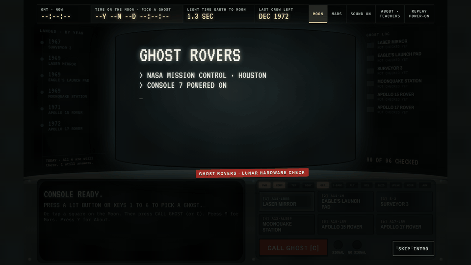
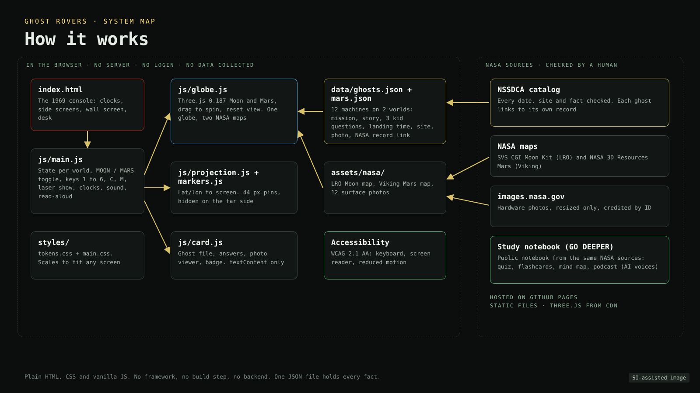
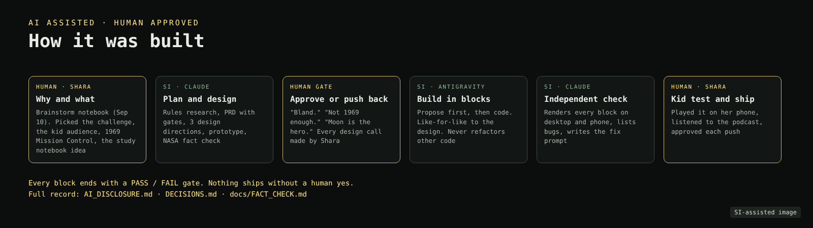

<div align="center">



# Ghost Rovers

**6 machines are still on the Moon. Only 1 still answers.**

A 1969 Mission Control console where kids ages 8 to 12 radio the hardware NASA left behind.

[**Play it live**](https://earlgreyhot1701d.github.io/ghost-rovers/) · [Study notebook](https://notebook.google.com/notebook/c43a9882-26f7-4223-a46c-3f5c332dd378) · [Fact check](docs/FACT_CHECK.md) · [SI disclosure](AI_DISCLOSURE.md)

NASA Space Apps Challenge 2026 · **Abandoned but not Forgotten** · Team **Clew Labs** (La Shara Cordero)

</div>

---

## The problem

Kids hear about rockets launching. They almost never hear about what stayed behind. The facts are all in NASA's catalog, but they read like a spec sheet: COSPAR IDs, coordinates, mass budgets. Nobody tells a 9-year-old that a car has been parked on the Moon since before their grandparents had cell phones.

## What Ghost Rovers does

You sit at a Mission Control console. Six machines are out there. You pick one and press **CALL GHOST**.

Five stay quiet. One answers: the Apollo 11 Laser Mirror. Scientists on Earth still bounce lasers off it, and you watch the beam make the 2.5-second round trip.

| The 6 ghosts | Landed | Today |
|---|---|---|
| Surveyor 3 | Apr 20, 1967 | Quiet since 1967 |
| Laser Mirror | Jul 20, 1969 | **Still answers** |
| Eagle's Launch Pad | Jul 20, 1969 | Resting since 1969 |
| Moonquake Station | Nov 19, 1969 | Switched off 1977 |
| Apollo 15 Rover | Jul 30, 1971 | Parked since 1971 |
| Apollo 17 Rover | Dec 11, 1972 | Parked since 1972 |

## What a kid can do

- **Spin the real Moon.** A 3D globe wrapped in NASA's Lunar Reconnaissance Orbiter map, with the 4 landing sites marked.
- **Call each ghost** and get its reply, with radio static and a 1969 console sound.
- **Read its file:** the original mission, a short story in the machine's own voice, and 3 questions kids actually ask ("Could I drive it?" "What's it made of?").
- **See the real photo** big, in a slide viewer, credited by NASA ID.
- **Watch the clock.** A live counter shows how long each machine has been on the Moon, down to the second.
- **Tap READ TO ME** to hear the file read aloud.
- **Finish all 6** to earn a Junior Flight Controller badge, then keep going with a quiz, flashcards, and a mind map.

## Built on NASA data, checked by a human

| Source | Used for |
|---|---|
| [NSSDCA catalog](https://nssdc.gsfc.nasa.gov/) | Every date, site, and fact. Each ghost links to its own record |
| [NASA SVS CGI Moon Kit](https://svs.gsfc.nasa.gov/4720) | LRO color map for the 3D Moon |
| [images.nasa.gov](https://images.nasa.gov/) | 6 hardware photos, resized only |
| [NASA JPL](https://www.jpl.nasa.gov/news/the-apollo-experiment-that-keeps-on-giving/) | Laser ranging: still working, Moon drifts 3.8 cm a year |

All 6 ghosts were checked line by line against NASA's records. The check caught overclaims and fixed them. Example: "the first car on the Moon" became "the first car astronauts drove on the Moon," because a Soviet robot rover got there first in 1970. Full log: [docs/FACT_CHECK.md](docs/FACT_CHECK.md).

## How it works



Plain HTML, CSS, and vanilla JavaScript. No framework, no build step, no server, no login, and no data collected. One JSON file holds every fact. Three.js draws the Moon.

| File | Job |
|---|---|
| `index.html` | The console: clocks, side screens, curved wall screen, desk |
| `js/main.js` | State, boot sequence, keys, laser show, clocks, sound, read-aloud |
| `js/globe.js` | 3D Moon, drag to spin, FACE EARTH |
| `js/projection.js`, `js/markers.js` | Latitude and longitude to screen pins |
| `js/card.js` | Ghost file, answers, photo viewer, badge |
| `data/ghosts.json` | The 6 ghosts, every fact sourced |
| `tools/render_moon.py` | Builds the near-side Moon image from NASA's map |

## Accessibility

Built to WCAG 2.1 AA from day one, because a kids' app should work for every kid.

- Full keyboard play: keys 1 to 6 pick a ghost, C calls, Escape closes
- Screen reader labels on every control, plus calm announcements for call results
- 44 px tap targets, visible focus rings, 4.5:1 contrast
- Respects reduced motion: no spinning, no beam animation
- READ TO ME for early and struggling readers
- Fits phones, tablets, and laptops without scrolling

## How it was built



Space Apps 2026 calls AI "Super Intelligence (SI)." We used it, and we documented all of it.

- **Human:** the why, the challenge pick, the kid audience, the 1969 look, every design call, every approval.
- **SI:** research, planning, code, and checking.
- **Rule:** nothing shipped without a human yes.

The full record is in [AI_DISCLOSURE.md](AI_DISCLOSURE.md) and [DECISIONS.md](DECISIONS.md). Images made with SI carry a visible "SI-assisted image" label. NASA photos and data are NASA's, used as-is.

## Run it locally

```bash
git clone https://github.com/earlgreyhot1701D/ghost-rovers.git
cd ghost-rovers
python3 -m http.server 8000
# open http://localhost:8000
```

## What's next

- Mission Control voice clips, recorded by a human
- Ghost names with personality
- Mars: the rovers and landers that went quiet there
- Spanish

## Credits

Built by **La Shara Cordero**, team Clew Labs. Images and data: NASA. Fonts: Google Fonts (SIL Open Font License). 3D: Three.js (MIT).

*AI assisted. Human approved.*
